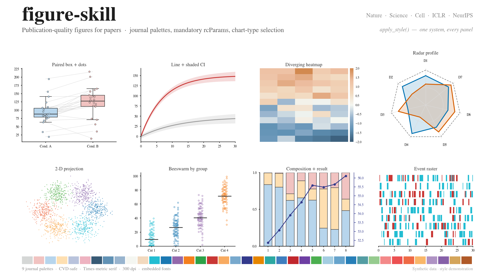

# figure-skill



A Claude skill (and a standalone matplotlib toolkit) for making
publication-quality figures for papers — Nature / Science / Cell / ICLR /
NeurIPS. It bundles journal-grade color palettes, the mandatory matplotlib
rcParams, a "what data uses what chart" decision guide, and a ready-to-import
style module, so every panel in a paper reads as one system.

## Contents

| File | What it is |
|---|---|
| `SKILL.md` | The skill entry point: the hard rules (font, column width, type size, rcParams) + universal style principles + workflow. |
| `figure_style.py` | Import it, call `apply_style()`, draw with the named CVD-safe palettes and correct figure widths. |
| `references/palettes.md` | 9 journal-grade color palettes + the full style rules. |
| `references/chart-selection.md` | Data-shape → chart-type cheat sheet and 15 chart families, each with when to use / when not / the trap. |
| `references/examples/` | Gallery: four full-page layout reproductions, ten single-chart examples and the 16:9 banner — all original, synthetic data, regenerable. |

## Quick start

```python
from figure_style import apply_style, WIDTH_FULL, CS_PEER_PALETTE, peer
import matplotlib.pyplot as plt

apply_style()                              # mandatory rcParams, once
fig, ax = plt.subplots(figsize=(WIDTH_FULL, 3.0))
for i, series in enumerate(data):
    c, m = peer(i)                         # one entity -> one (color, marker)
    ax.plot(series.x, series.y, color=c, marker=m, label=series.name)
fig.savefig("fig1.pdf")                    # vector; then rasterize and eyeball it
```

## Install as a skill

The layout follows the `SKILL.md` convention, so the same directory installs
into both Claude Code and Codex. The agent reads `SKILL.md` and pulls in
`references/` and `figure_style.py` when a task involves drawing a paper figure,
choosing chart colors, or picking a chart type.

**One-liner (clones into both):**

```bash
bash install.sh                 # installs into ~/.claude/skills and ~/.codex/skills
bash install.sh --claude        # Claude Code only
bash install.sh --codex         # Codex only
```

**Or by hand** — copy the repo into the skills folder, keeping the directory name:

```bash
# Claude Code
git clone git@github.com:zqinglin/figure-skill.git ~/.claude/skills/figure-skill
# Codex
git clone git@github.com:zqinglin/figure-skill.git ~/.codex/skills/figure-skill
```

The result is `<skills-dir>/figure-skill/SKILL.md`.

## The four things it fixes

A figure reads as amateur or professional before a reviewer parses a single
number:

1. **Font** — serif, Times-compatible, with a fallback chain that doesn't
   silently drop to DejaVu.
2. **Size** — authored at final printed width so the 8-9pt type stays 8-9pt on
   the page.
3. **Color** — muted, luminance-balanced, colour-vision-deficiency safe.
4. **Chart type** — chosen from the data shape, not from habit.
