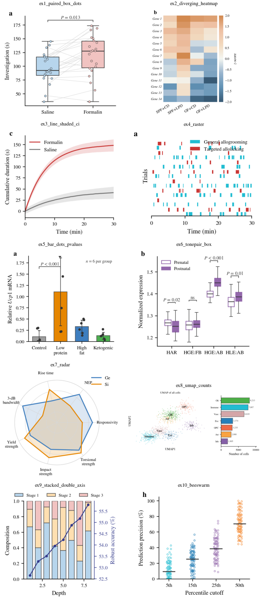
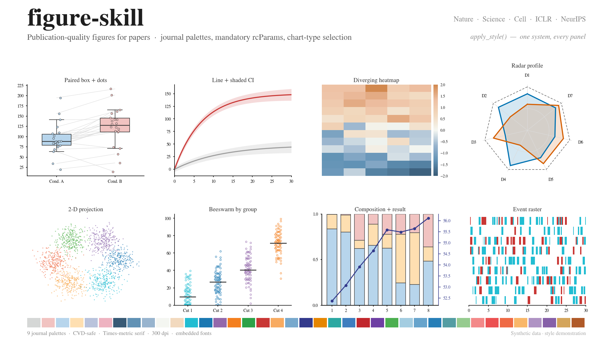

# Example gallery

Everything here is **original**: synthetic data drawn only with
`figure_style.apply_style()` and the palettes in `../palettes.md`. Nothing is
copied from a published figure — these reproduce the *layout conventions* of
top-journal figures so you have a visual target for each chart family in
`../chart-selection.md`. Every figure carries a "synthetic data" mark so it can
never be mistaken for a result.

Regenerate everything:

```bash
python3 make_examples.py          # the ten single-chart examples + gallery.png
python3 layout1_timecourse_panel.py
python3 layout2_collage.py
python3 layout3_atlas.py
python3 layout4_radar_variants.py
python3 make_hero.py              # the 16:9 banner
```

## Full-page layouts

The four canonical journal page layouts, panel-for-panel.

| File | Layout | Panels |
|---|---|---|
| `layout1_timecourse_panel.png` | Time-course page | raster pair (a) → cumulative curves ×5 (b) → binned area ×5 (c) → paired boxes ×8 (d–k) |
| `layout2_collage.png` | Eight-panel collage | distribution box (A), stacked proportion (B), line-over-bar double axis ×3 (C–E), two-tier diagnostic (F), value-labelled bars (G), wide beeswarm (H) |
| `layout3_atlas.png` | 2-D projection atlas | main projection (D), sorted counts (E), two sub-population projections with count lists (F, G), three detail projections (H–J) |
| `layout4_radar_variants.png` | One chart, five palettes | hero radar + 2×2 palette variants in titled boxes |

## Single-chart examples



| File | Chart family | Palette | Shows |
|---|---|---|---|
| `ex1_paired_box_dots.png` | Paired box + dots | P1 soft pastel | two groups, per-unit connecting lines, bracket |
| `ex2_diverging_heatmap.png` | Heatmap | P2 blue–white–orange | zero-centered matrix, minimal colorbar |
| `ex3_line_shaded_ci.png` | Line + shaded CI | P5 / neutral | cumulative curve with ±SD band, not error bars |
| `ex4_raster.png` | Raster | teal + coral | event spans across trials, two event types |
| `ex5_bar_dots_pvalues.png` | Bar + individual dots | P6 many-category | means with dots, bracket, single `n` note |
| `ex6_tonepair_box.png` | Tone-pair box | P3 deep/light | hollow vs filled pairing across groups |
| `ex7_radar.png` | Radar / spider | CVD-safe pair | two entities over 7 normalized dimensions |
| `ex8_umap_counts.png` | Projection + count bar | P7 / P8 / P9 | 2-D projection with in-place labels + sorted counts |
| `ex9_stacked_double_axis.png` | Stacked bar + line | P1 + P5 navy | composition drift (left) vs result metric (right) |
| `ex10_beeswarm.png` | Beeswarm | P3 deep | per-point distribution with median line, by group |

## Banner

`hero.png` — 1920×1080 (exact 16:9), eight miniatures plus the palette strip,
drawn natively rather than stitched from the PNGs above so it stays crisp.



Swap the synthetic data for yours and keep the styling.
